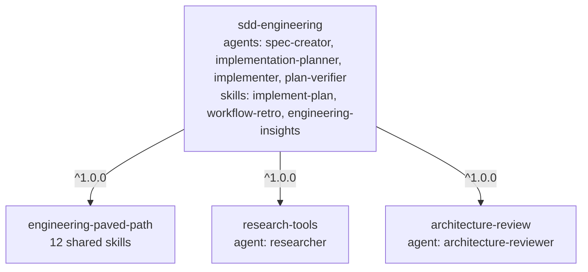

# SDD plugins specification

> Draft v2. Names come from the real project (`ai-dev-digest/.claude/agents`, `.claude/skills`) and the team's lab steps 2 to 7. Where the lab uses a different name, the real name wins and the difference is noted. The marketplace is `dev-digest-marketplace`, so installs read `/plugin install <plugin>@dev-digest-marketplace`.

## Goal

Release the Spec-Driven Development (SDD) harness from `ai-dev-digest` as four independently released plugins: one orchestration plugin, `sdd-engineering`, and three dependency plugins. This document fixes names, contents, dependencies, what does not move, and how the result is validated. It builds nothing.

## What moves and what does not

Every component is sorted into one of four groups. A file ships only if it is **reusable** and we can name its owner, its consumer scenario and why it is updated together with the rest of its plugin (kept as a file inventory in each plugin PR).

| Group | Examples | Ships? |
| :- | :- | :- |
| Reusable | agents, skills, evals without product paths | yes |
| Project-specific | `CLAUDE.md`/`AGENTS.md`, product specs, module names, DevDigest-only rules | no |
| Optional integrations | MCP and anything with network access or credentials (`github-connection`) | no, for now |
| Local leftovers | cache, personal memory, experiments, absolute paths | no |

Not migrated, explicitly: product specs, secrets, cache, DevDigest-specific instructions.

## Plugin map

```text
sdd-engineering@1.0.0
├── engineering-paved-path@^1.0.0
├── research-tools@^1.0.0
└── architecture-review@^1.0.0
    └── engineering-paved-path@^1.0.0
```

| Plugin | Contents | Depends on |
| :- | :- | :- |
| `engineering-paved-path` | 12 shared skills (below), one source for all agents | none |
| `research-tools` | agent `researcher` (read-only) | none |
| `architecture-review` | agent `architecture-reviewer`, generalized | `engineering-paved-path` `^1.0.0` |
| `sdd-engineering` | agents `spec-creator`, `implementation-planner`, `implementer`, `plan-verifier`; skills `implement-plan`, `workflow-retro`, `engineering-insights`; `evals/`; `README.md`, `CHANGELOG.md`, `COMPATIBILITY.md` | the three above, all `^1.0.0` |

Real names versus the lab: "run-plan" is `implement-plan` in the project (kept; rename only if the team decides so), "Specreator" is `spec-creator`.

### `engineering-paved-path` skills

| Area | Skill |
| :- | :- |
| React / testing | `react-best-practices`, `react-testing-library` |
| Next.js | `next-best-practices` |
| Fastify | `fastify-best-practices` |
| Architecture | `onion-architecture`, `ui-frontend-architecture` |
| Data | `drizzle-orm-patterns`, `postgresql-table-design`, `zod` |
| Cross-cutting | `typescript-expert`, `security`, `mermaid-diagram` |

Only skills with a real SDD consumer stay (the list matches what `implementation-planner`, `implementer`, `architecture-reviewer` and `spec-creator` load today). `engineering-insights` is not here: it goes into `sdd-engineering` (see below). Twelve descriptions are above the ~500-token always-loaded proposal in [COST-BASELINE.md](COST-BASELINE.md): measure with `site/scripts/build-index.mjs`, record the real number, and either accept it as a documented exception or trim.

## Components of `sdd-engineering`

| Component | Role | Notes for the extraction |
| :- | :- | :- |
| `spec-creator` | Spec with EARS acceptance criteria, no implementation details | Writes under a spec folder given as input (default `specs/`) |
| `implementation-planner` | Plan from an existing spec | Reads the spec; never invents requirements; plan folder is an input (default `docs/plans/`) |
| `implementer` | Executes the plan, runs the tests | If no test command is found, reports it instead of guessing |
| `plan-verifier` | Checks acceptance criteria and plan items, read-only | Unchanged contract: PASS/FAIL/PARTIAL/NOT-VERIFIED |
| `implement-plan` (skill) | Runs the approved plan: `implementer`, then the architecture review gate with a capped fix loop, then `plan-verifier` | Generalized: drops `security-reviewer`, `skip_security` and the `pr-self-review` merge gate (not shipped); the final report is plan-verifier status plus open findings |
| `workflow-retro` (skill) | Retrospective of a finished run, manual only (`disable-model-invocation: true`) | Appends to a ledger path given as input (default `docs/retro/ledger.md`) |
| `engineering-insights` (skill) | Procedure for capturing non-obvious learnings | Ship the procedure **without** the captured DevDigest entries and module names |
| `evals/` | Behavior evals (see Validation) | New cases; the current `ai-dev-digest/evals` runner (vitest + Agent SDK) is reused |

Agents keep `model: sonnet` and today's `tools:`. Plugin agents ignore `hooks`, `mcpServers` and `permissionMode`; none uses them.


`spec-creator` and `implementation-planner` are run by hand so a human sees the spec and plan before implementation tokens are spent. Agents never call each other; the main session (or the `implement-plan` skill) spawns them. `spec-creator` tags questions for research as `[NEEDS CLARIFICATION] (for: researcher)`.

## Packaging rules

- Cross-plugin references use the namespace: `engineering-paved-path:react-best-practices`, `research-tools:researcher`, `architecture-review:architecture-reviewer`. Own components are also referenced by full name where a field expects a plugin-scoped reference.
- Plugin-level files: `${CLAUDE_PLUGIN_ROOT}`. Scripts inside a skill: `${CLAUDE_SKILL_DIR}`. Never `.claude/skills/` or an absolute path.
- DevDigest paths and module names are removed and replaced by explicit inputs. `architecture-reviewer` reads repository-local architecture docs (for example `AGENTS.md`) instead of hard-coded checks (`vendor/shared`, migration journal, `reviewer-core`).
- No credentials in manifests. Duplicate instructions between agent prompts and skills are merged.
- `COMPATIBILITY.md` states Claude Code `>=2.1.110` (version-constrained dependencies). A newer feature raises it, with the docs reference.
- `README.md` of `sdd-engineering`: purpose, install, the pipeline above, where specs and plans are created, inputs and defaults, Requires, Data and network, Sources. `CHANGELOG.md` in every plugin: one `## [X.Y.Z] - date` per release, matching `plugin.json`; the version itself lives only in `plugin.json`.

## Registration

Four entries in `.claude-plugin/marketplace.json` (`name`, `source`, `description`, `category`, `tags`), four `CODEOWNERS` lines, rows in the root README. The version stays in `plugin.json` only, as in [CONTRIBUTING.md](../CONTRIBUTING.md); owners come from `CODEOWNERS` and `author`. `sdd-engineering/plugin.json` declares the three dependencies from the map. A commit or tag of the marketplace then fixes the catalog state. Release order, each plugin in its own PR and release PR (`scripts/release.sh <plugin> 1.0.0`): `engineering-paved-path` and `research-tools`, then `architecture-review`, then `sdd-engineering`. The current placeholder skills are removed (all plugins are `0.1.0`, no tags exist).

## Validation before release

1. `claude plugin validate .` and `claude plugin validate ./plugins/<name>` for each plugin (no `--strict`; it is not a documented flag), plus `scripts/validate.sh`.
2. Load all four with `claude --plugin-dir ./plugins/<name>` (one flag per plugin). `claude plugin list --json` shows no `dependency-unsatisfied`, `range-conflict` or `no-matching-tag`.
3. Behavior evals: `spec-creator` asks the needed questions and writes a spec without implementation details; `implementation-planner` reads the existing spec; `implement-plan` hands tasks to `implementer`; the review gate calls `architecture-reviewer`; `plan-verifier` checks the acceptance criteria; `workflow-retro` runs only on explicit request; namespaced skills load without warnings; an unrelated prompt does not activate the workflow.
4. Schema validation checks file shape, evals check that the composition works; both are required.

## Risks and open questions

1. **Namespaced `skills:` preload.** Cross-plugin preloading in agent frontmatter is not documented. Spike with `claude --debug` using `engineering-paved-path:<skill>`. Fallback: drop `skills:` and invoke the dependency skill through the Skill tool.
2. **Third-party skills.** From `skills-lock.json`: `drizzle-orm-patterns` (giuseppe-trisciuoglio/developer-kit), `fastify-best-practices` (mcollina/skills), `next-best-practices` (vercel-labs/next-skills), `postgresql-table-design` (wshobson/agents), `typescript-expert` (sickn33/antigravity-awesome-skills), `zod` (pproenca/dot-skills). Check licences before republishing; add a Sources table. Origin of `security`, `mermaid-diagram`, `react-testing-library`, `onion-architecture`, `ui-frontend-architecture`, `react-best-practices` is not in the lock file: confirm.
3. **Eval fixtures.** Existing `architecture-reviewer` fixtures are DevDigest-specific (`reviewer-core-gate`, `route-drizzle-import`); write generic ones. Decide whether the runner is copied into `sdd-engineering/evals/` or stays in `ai-dev-digest`.
4. **Two copies drift.** After release this marketplace is the source of truth and `ai-dev-digest` installs the plugins. The Codex sync (`scripts/sync-codex-agents.mjs`) is not covered by plugins and stays there.
5. **Catalog site.** Built as React + Vite per [SITE-SPEC.md](SITE-SPEC.md). Its builder must read `CHANGELOG.md` and `COMPATIBILITY.md`, which the plugins above will contain.

## Out of scope

`pr-self-review`, `security-reviewer`, `test-writer`, `doc-writer`, `brainstorm`, `dependency-checker`, `github-connection`, `skill-creator-plugin` stay in `ai-dev-digest`. They can become later releases once generalized.

## Dependency graph


